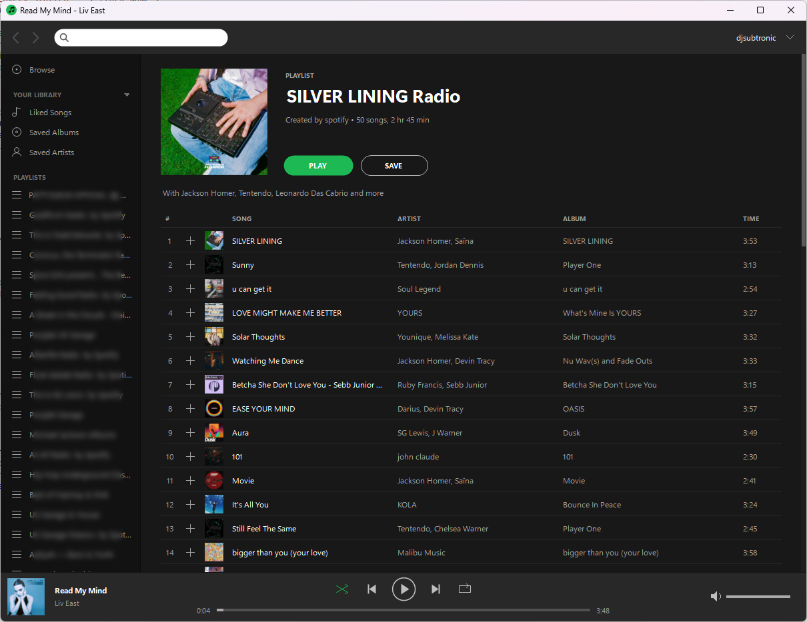

# Spotipaq

Spotipaq is an unofficial Spotify desktop client for Windows XP, written with low-end, pre-SSE x86 computers in mind. It was developed and tested on a Compaq Armada 7400 with a 366 MHz Pentium II running Windows XP SP3.

The application uses a .NET Framework 2.0 Windows Forms interface and a native 32-bit DLL for networking, cryptography, Vorbis audio decoding and `waveOut` output. It is intended for personal experimentation and retro-computing use, not as a supported alternative to Spotify's official clients.

**A Spotify Premium account is required for music playback.** Spotipaq is not affiliated with or endorsed by Spotify.



## Functionality

- Spotify account login and reusable local credentials.
- Browse playlists, albums, artists and saved music.
- Search for music and navigate between artist, album and playlist pages.
- Play tracks from playlists and other track lists, with queue navigation, shuffle, repeat, seeking and volume control.
- Select 96, 160 or 320 kbps Ogg Vorbis streams, subject to availability.
- Playlist and library management, including following/saving playlists.
- Lazy-loaded cover artwork with a persistent on-disk cache and a bounded decoded-thumbnail cache.
- Progressive audio downloading, retries and recovery from intermittent CDN failures.

This software uses Spotify's private service interfaces. Functionality can stop working if Spotify changes its protocols, authentication or backend behaviour.

## Architecture

The solution consists of two main projects:

| Component | Implementation | Responsibility |
| --- | --- | --- |
| `Spotipaq/` | C#, .NET Framework 2.0, Windows Forms | Interface, navigation, library and playlist operations, playback coordination |
| `SpotipaqNative/` | C, Win32, OpenSSL 1.0.2u | TLS/HTTPS, big-number operations, audio decoding and `waveOut` playback |

The UI is largely custom drawn rather than browser-based. The audio path is native and designed for x86 processors without SSE support.

### Main source files

| File | Purpose |
| --- | --- |
| `Spotipaq/MainForm.cs` | Main window, navigation and playback queue |
| `Spotipaq/PageView.cs` | Owner-drawn page content and lists |
| `Spotipaq/Chrome.cs` | Sidebar, toolbar and now-playing controls |
| `Spotipaq/Theme.cs` | Drawing utilities, artwork loading and caching |
| `Spotipaq/Model.cs`, `Backend.cs` | Data models and UI/backend interfaces |
| `Spotipaq/Engine/SpotifyBackend.cs` | Spotify browsing and library operations |
| `Spotipaq/Engine/SpotifyPlayback.cs` | Track loading, audio-key requests and streaming recovery |
| `Spotipaq/Engine/SpotifyEngine.cs` | Session setup and credential storage |
| `Spotipaq/Engine/ApSession.cs` | Spotify Access Point connection and packets |
| `Spotipaq/Engine/Spclient.cs` | Spotify service requests |
| `Spotipaq/Engine/OAuthLogin.cs` | Login flow |
| `Spotipaq/Engine/Proto.cs`, `Shannon.cs` | Protocol serialization and cryptographic support |
| `Spotipaq/Engine/Native.cs` | Native DLL interop and logging |
| `SpotipaqNative/spqnative.c` | Native HTTP/TLS and cryptographic helpers |
| `SpotipaqNative/spq_audio.c` | Native audio buffering, playback and output |
| `SpotipaqNative/spq_vorbis.c` | Vorbis decoder |
| `SpotipaqNative/build.cmd` | Native build script |

The repository may also contain mock-backend code used during initial UI development; normal operation uses the real Spotify backend.

## Requirements

### Running

- Windows XP SP3 (primary tested operating system).
- 32-bit x86 computer; the native code is compiled for processors without SSE.
- .NET Framework 2.0.
- Internet connection and Spotify Premium subscription.
- `SpotipaqNative.dll` alongside the application executable at runtime.

Other Windows versions and hardware configurations have not been systematically tested.

### Building

The included native build script targets the following environment:

- Visual Studio 2017 Build Tools with the v141 C/C++ toolchain (MSVC 14.16), x86 compiler and Windows SDK 10.0.19041.0.
- A static **OpenSSL 1.0.2u** build for x86/Windows XP, including headers and `ssl.lib` / `crypto.lib`. The OpenSSL build must itself be suitable for the target CPU.
- Visual Studio/MSBuild support for .NET Framework 2.0 projects and the .NET 2.0 targeting assemblies.
- NuGet dependencies restored for the managed project, including `Newtonsoft.Json` (see `Spotipaq/packages.config`).

`SpotipaqNative/build.cmd` uses `OPENSSL_XP` when set, otherwise it looks for `openssl-1.0.2u-xp` beside the `SpotipaqNative` directory. As a third option, place a plain-text file named `SpotipaqNative/openssl.local.user` containing the absolute path to your OpenSSL directory (one line only). Both the build script and the Visual Studio project recognise this local override. `*.user` files are excluded by the repository's `.gitignore`, so your personal OpenSSL location is not committed. The build script also expects the stated Visual Studio Build Tools installation and SDK; these paths may need adapting on other machines.

### Build steps

From a Windows command prompt in the repository root:

1. Provide an XP-compatible OpenSSL 1.0.2u build. For example:

   ```bat
   set "OPENSSL_XP=C:\path\to\openssl-1.0.2u-xp"
   ```

   Alternatively, place the OpenSSL folder beside `SpotipaqNative`, or create `SpotipaqNative/openssl.local.user` with its full path (without quotes). An `OPENSSL_XP` environment variable takes precedence over these fallbacks. If using the environment variable with Visual Studio, set it before launching Visual Studio.

2. Build the native DLL:

   ```bat
   cd SpotipaqNative
   call build.cmd
   cd ..
   ```

   The script compiles the native source for 32-bit x86 with `/O2`, `/MT` and `/arch:IA32`, checks the compiled project objects for SSE instructions and copies `SpotipaqNative.dll` to `Spotipaq\native\`.

3. Open `Spotipaq.sln` in Visual Studio, restore managed dependencies if necessary, and build the **Release** configuration. The managed project targets x86 and .NET Framework 2.0.

4. Place `SpotipaqNative.dll` beside the built `Spotipaq.exe`, then run the application.

The native script does **not** automatically copy the DLL into `bin\Release`, so the final deployment copy is a separate step. No installer or automated release packaging is provided.

## Configuration and local data

Spotipaq stores user-specific state under `%APPDATA%\Spotipaq\`. Depending on the build, this includes locally protected account credentials, logs, artwork cache files and optional configuration files.

| Path | Use |
| --- | --- |
| `%APPDATA%\Spotipaq\credentials.dat` | Locally stored login credentials |
| `%APPDATA%\Spotipaq\spotipaq.log` | Application log |
| `%APPDATA%\Spotipaq\artcache\` | Persistent artwork cache (up to 256 MB) |
| `%APPDATA%\Spotipaq\quality.txt` | Optional playback quality: `96` or `320`; otherwise defaults to `160` |
| `%APPDATA%\Spotipaq\verbose.txt` | If present, enables more detailed diagnostic logging |

The artwork cache is designed to retain compressed images on disk while limiting decoded thumbnail caching in RAM to approximately 4 MB. Routine operations should not need to re-download artwork already cached from earlier playlist visits.


## Limitations

- This client depends on undocumented Spotify endpoints and protocols, which can change without notice.
- Network and CDN timeouts can still produce delayed starts or temporary interruptions; the playback layer attempts to recover rather than stopping immediately.
- The native network stack uses legacy OpenSSL because of the Windows XP compatibility target. OpenSSL 1.0.2u is obsolete and should not be treated as a modern security baseline.
- Compatibility and performance were primarily evaluated on one Windows XP/Pentium II system.
- The repository is provided as source code; there are no guarantees of continued functionality.

## Project status and maintenance

**This is a personal project and is not actively maintained.** It was built to see whether a useful Spotify client could run on a late-1990s laptop, and it has achieved that purpose.

I do not intend to continue long-term development, maintain compatibility with future Spotify changes, provide technical support, or regularly review issues and pull requests. The source is published so that others can inspect it, learn from it, fork it and develop their own versions if they wish.

Please do not treat this repository as a commitment to ongoing maintenance.

## Third-party software and legal notes

Spotify and related names are trademarks of their respective owners. This project is independent and unofficial. A Spotify Premium subscription does not imply Spotify has authorised this implementation.

The project uses OpenSSL and Newtonsoft.Json, and may contain other third-party-derived material. Anyone redistributing the code or compiled software must comply with the applicable component licences and preserve required notices. **Review the repository's full dependency and source provenance before assigning a licence or redistributing third-party code.**

This project does not include music files or grant rights to Spotify's content or services.
